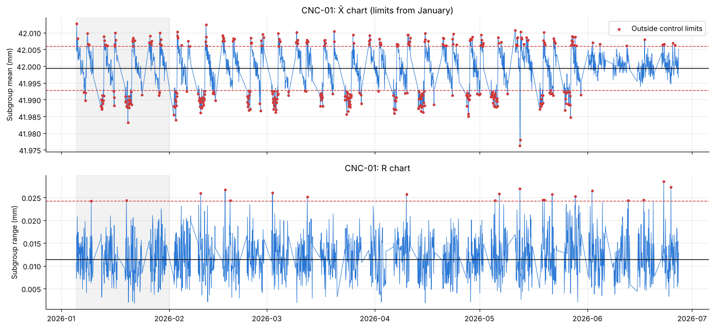
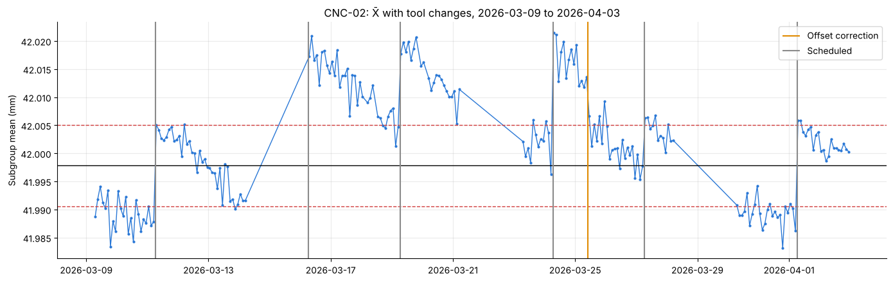
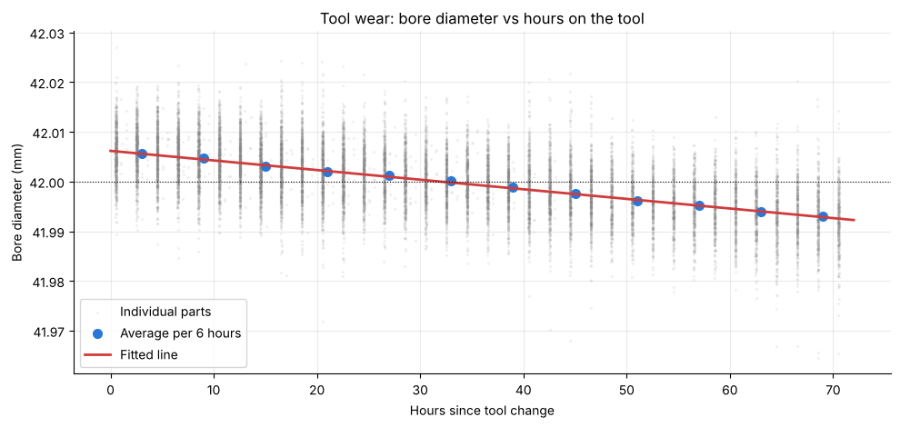
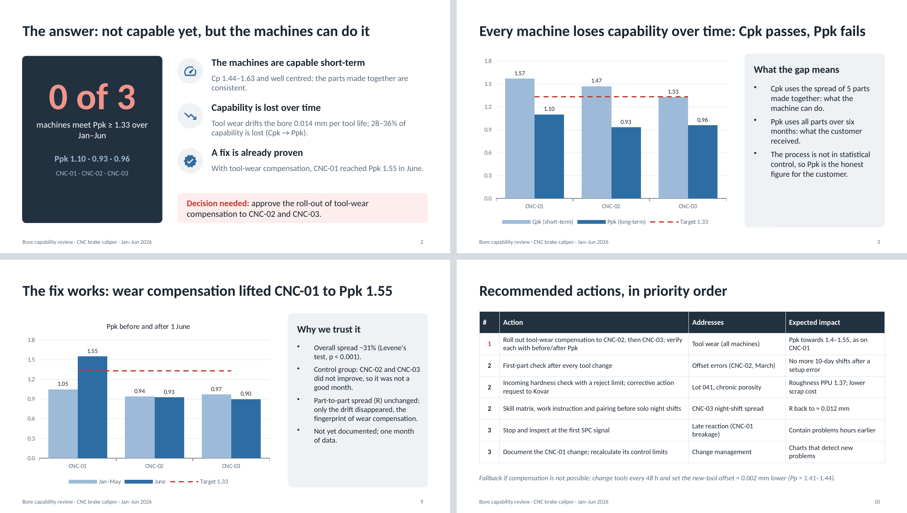

# SPC Capstone: CNC Brake Caliper Bore Capability

**An end-to-end quality analytics project in SQL, Python and Power BI, finishing with a stakeholder deck.**

A plant machines the piston bore of an aluminium brake caliper on three CNC machines. The customer requires **Cpk ≥ 1.33** for the PPAP review. The Quality Manager asks:

> **Is the process capable? If not, why not, and what should we fix first?**


---

## The answer

**Not yet: 0 of 3 machines meet Ppk ≥ 1.33 (1.10, 0.93, 0.96). But the machines themselves are capable, and the causes are known and fixable.**

| Finding | Evidence |
|---|---|
| The machines are capable short-term | Cp 1.44–1.63, well centred (Cpk only 3–8% below Cp) |
| 28–36% of capability is lost **over time** | Cpk 1.57 / 1.47 / 1.33 vs Ppk 1.10 / 0.93 / 0.96; the process is not in statistical control (27–28% of subgroups outside the X̄ limits) |
| **Root cause 1: tool wear** (all machines) | Bore shrinks 0.000193 mm/h: **0.014 mm per 72 h tool life, 28% of the tolerance**, a sawtooth on every X̄ chart |
| **Root cause 2: offset error** at tool changes (CNC-02, 16–25 Mar) | New tools started 0.013 mm high with a normal wear rate; fixed by an offset correction mid-tool; 11 parts above the USL |
| **Root cause 3: over-hard material lot** (L-2026-041, 25–29 May) | 242 HB vs 199–213 HB; **195 defects per 1,000**; 137 of 140 roughness failures. Without it, roughness PPU = 1.37 |
| Late reaction to a tool breakage (CNC-01, 12 May) | X̄ and R signalled at 15:00; tool replaced at 17:30 |
| Wider night-shift spread (CNC-03, from April) | 1.6× wider within-subgroup spread after an operator change (Levene's test, p ≈ 10⁻⁴⁴), treated as an onboarding gap |
| Cost priority differs from count priority | Porosity is 4th by count but **1st by cost** (scrapped at €18.50 vs reworked at €4.20) |
| **A fix already works** | Tool-wear compensation on CNC-01 from 1 June: **Ppk 1.05 → 1.55**, spread −31%; the control group did not improve |

### Recommended actions

1. **Roll out tool-wear compensation** to CNC-02 and CNC-03, verifying each with a before/after capability study.
2. **First-part check** after every tool change.
3. **Incoming hardness check** at goods receipt, plus a supplier corrective action request.
4. **Onboarding**: skill matrix and work instruction before solo night shifts.
5. **Stop and inspect** at the first SPC signal.
6. **Document** the CNC-01 change and recalculate its control limits.

Fallback if compensation is not possible: a 48 h tool-change interval with a re-centred new-tool offset.

---

## Repository structure

```
├── data/            raw CSVs (8 tables) + cleaned exports used by Power BI   → data/README.md
├── sql/             MySQL scripts: database load + questions Q1–Q6
├── python/          Jupyter notebook: cleaning, SPC, capability, statistics (Q1–Q9)
├── powerbi/         dashboard (.pbix), PDF export, model and DAX notes        → powerbi/README.md
├── presentation/    stakeholder deck for the Quality Manager (.pptx and .pdf)
└── images/          charts and screenshots used in this README
```

---

## 1. SQL (MySQL 8): business questions

| Script | Question | Key result |
|---|---|---|
| [`00_create_and_load_database.sql`](sql/00_create_and_load_database.sql) | Create `spc_capstone` and load all 8 tables | Empty cells loaded as real NULLs |
| [`01_data_profiling_and_cleaning.sql`](sql/01_data_profiling_and_cleaning.sql) | Profile and clean the measurements | 90 missing, 14 impossible, 38 duplicates; two timestamp formats parsed with `REGEXP` + `STR_TO_DATE`; `measurements_clean` built with `ROW_NUMBER()` |
| [`02_overall_quality.sql`](sql/02_overall_quality.sql) | Parts, defects, rate, cost | 253,374 parts · 4,489 defective · 17.72 per 1,000 · €28,577.80 |
| [`03_defect_pareto.sql`](sql/03_defect_pareto.sql) | Pareto by count vs by cost | The rankings disagree: porosity is 4th vs 1st |
| [`04_where_and_when.sql`](sql/04_where_and_when.sql) | Rate by machine, shift, month | May = 56 per 1,000 (5× normal); shift C elevated from April |
| [`05_supplier_lot_scorecard.sql`](sql/05_supplier_lot_scorecard.sql) | Lot and supplier scorecard | Lot 041: 195 per 1,000 at 242 HB; Kovar porosity chronic (3.87 vs 1.50 / 1.34) |
| [`06_tool_changes.sql`](sql/06_tool_changes.sql) | Defects around unplanned tool changes | Oversize parts only on CNC-02's tool-change days in March; undersize defects at the CNC-01 breakage |

**Techniques:**
- CTEs, window functions (`ROW_NUMBER`, `RANK`, running `SUM() OVER`) and conditional aggregation;
- range joins with `DATEDIFF`, plus `REGEXP` and `STR_TO_DATE`;
- **aggregating each table before joining**, to avoid join fan-out.

---

## 2. Python: statistical process control

[`python/spc_capstone_analysis.ipynb`](python/spc_capstone_analysis.ipynb) uses pandas, NumPy, Matplotlib and SciPy. It runs top to bottom and reads from `data/`.

| Section | What it shows |
|---|---|
| 1. Cleaning | Mixed timestamps, duplicates and impossible values, with every decision documented |
| 2. X̄-R charts | Limits from a January baseline; Western Electric rules: **65–73% of subgroups trigger a rule** |
| 3. Pattern explanation | The sawtooth matches the tool-change log; the offset error and the breakage are confirmed |
| 4–5. Capability | Cp, Cpk, Pp, Ppk; histograms against the LSL/USL |
| 6. Stratification | R by shift and month; Levene's test on within-subgroup deviations |
| 7. Roughness | One-sided capability (CPU / PPU); correlation with hardness, with and without the outlier lot |
| 8. Improvement study | Before/after with a control group, Levene's test, and a check that R is unchanged |
| 9. Tool life | Regression of diameter on tool age; what-if Ppk / Pp by tool-change interval |



| Offset error found in the tool-change log | Tool wear, measured |
|---|---|
|  |  |

---

## 3. Power BI: interactive dashboard

The dashboard has three pages (Overview, Pareto, SPC) built on a **star-schema model** with **about 30 DAX measures**. Every figure was validated against SQL and Python, and Cpk/Ppk update live with the slicers. Details are in [`powerbi/README.md`](powerbi/README.md).

| Pareto | SPC |
|---|---|
|  |  |

---

## 4. Stakeholder deck

[`presentation/SPC_capstone_stakeholder_deck.pptx`](presentation/SPC_capstone_stakeholder_deck.pptx) has 12 slides for the Quality Manager: the answer first, then the root causes, the cost view, proof that a fix works, prioritised actions and the path to the PPAP review.



---

## How to reproduce

1. **SQL:** run `sql/00_create_and_load_database.sql` in MySQL 8 (it creates the `spc_capstone` database), then scripts `01` to `06` in order. Script `01` creates `measurements_clean`.
2. **Python:** `pip install -r python/requirements.txt`, then open the notebook and **Run All**.
3. **Power BI:** open `powerbi/SPC_quality_dashboard.pbix`. If Power BI asks for the data, point it to the `data/` folder.

## About the data

The dataset is **generated**, modelled on CNC bore machining, and was created for this practice project. The patterns were planted and then found blind. The methods are the same as on real plant data. See [`data/README.md`](data/README.md).

## Skills demonstrated

- **SPC:** X̄-R charts, Western Electric rules, Cp/Cpk/Pp/Ppk, capability analysis.
- **Statistics:** Levene's test, correlation, regression, before/after study with a control group.
- **SQL:** data profiling and cleaning, window functions, fan-out-safe aggregation.
- **Power BI:** data modelling (star schema) and DAX.
- **Quality engineering:** root-cause analysis, PPAP context, presenting findings to stakeholders.

---

**Areej Alsobh**, Quality Engineer (automotive) moving into quality data analytics.
