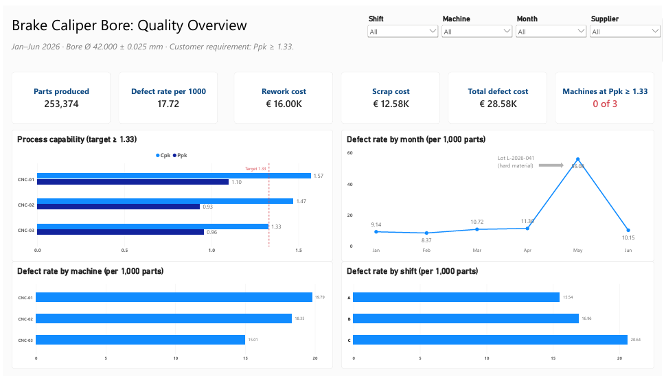
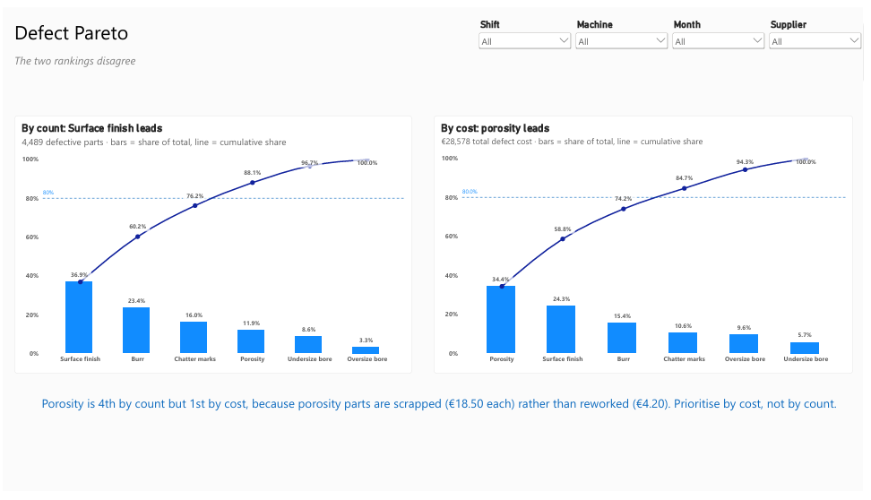
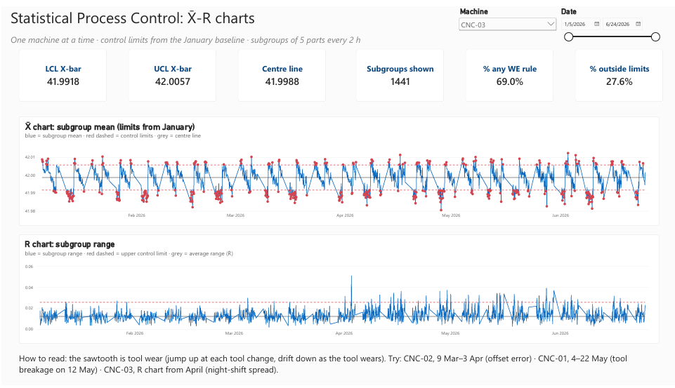
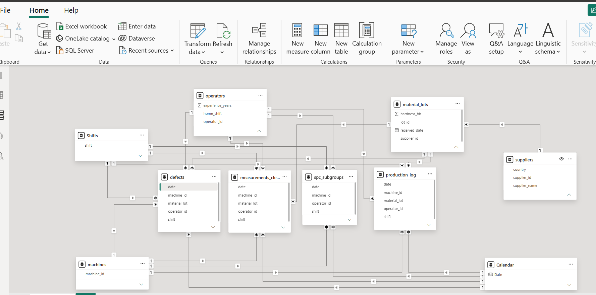

# Power BI dashboard

`SPC_quality_dashboard.pbix` opens in Power BI Desktop. `SPC_quality_dashboard.pdf` is a static export for viewing without Power BI.

| Page | Purpose |
|---|---|
|  | **Overview:** KPIs, Cpk vs Ppk per machine against the 1.33 target, and defect rate by month, machine and shift |
|  | **Pareto:** defects by count vs by cost; the two rankings disagree |
|  | **SPC:** X̄ and R charts for one machine at a time, with red out-of-control points and a date-range slider for zooming in on events |

## Data model



A star schema, connected through relationships (no merged tables), so each total is calculated in its own table:

- **Facts:** `production_log`, `defects`, `measurements_clean`, `spc_subgroups`.
- **Dimensions:** `Calendar` (DAX, marked as date table), `Shifts` (DAX), `machines`, `operators`, `material_lots` → `suppliers`.
- **20 relationships**, all many-to-one with single-direction filtering.
- `defects` has no lot column, so the lot is looked up from `production_log` in Power Query (left merge on date + shift + machine). `production_log` has exactly one row per key, so the merge cannot fan out. Checked: 1,734 rows before and after.
- Statistics (cleaning, control limits) come from Python; Power BI only presents them, so there is one source of truth.
- Regional setting: *Locale for import = English (United States)*, so decimal points are read correctly on a Hungarian-locale machine.

## Key DAX measures

```DAX
Defect rate per 1000 = DIVIDE([Defective parts], [Parts produced]) * 1000

Scrap cost = CALCULATE([Total defect cost], defects[disposition] = "Scrap")

Ppk =
VAR m = [Bore mean]                                  -- AVERAGE(measurements_clean[bore_diameter_clean])
VAR s = [Bore sigma overall]                         -- STDEV.S(measurements_clean[bore_diameter_clean])
RETURN DIVIDE(MIN(42.025 - m, m - 41.975), 3 * s)

Cpk =
VAR m = [Bore mean]
VAR s = [Bore sigma within]                          -- DIVIDE(AVERAGE(spc_subgroups[R]), 2.326)
RETURN DIVIDE(MIN(42.025 - m, m - 41.975), 3 * s)

Machines meeting target =
VAR ok = COUNTROWS(FILTER(VALUES(machines[machine_id]), [Ppk] >= 1.33))
RETURN COALESCE(ok, 0) & " of " & COUNTROWS(VALUES(machines[machine_id]))

Defect cumulative % =
VAR current_qty = [Defective parts]
VAR total_qty = CALCULATE([Defective parts], ALL(defects[defect_type]))
VAR cumulative_qty =
    SUMX(FILTER(ALL(defects[defect_type]), CALCULATE([Defective parts]) >= current_qty),
         CALCULATE([Defective parts]))
RETURN DIVIDE(cumulative_qty, total_qty)

X-bar out of limits =
IF(CALCULATE(COUNTROWS(spc_subgroups), spc_subgroups[x_out] = TRUE()) > 0, [X-bar])
```

## Validation

Every dashboard figure was checked against the SQL and Python results:

| Figure | Value |
|---|---|
| Parts produced | 253,374 |
| Defects | 4,489 (17.72 per 1,000) |
| Defect cost | €28,577.80 |
| Defect rate per machine | 19.79 / 18.35 / 15.01 per 1,000 |
| Cpk / Ppk | CNC-01 1.57 / 1.10, CNC-02 1.47 / 0.93, CNC-03 1.33 / 0.96 |
| Pareto | Surface finish 36.9% by count; Porosity 34.4% by cost |
| Subgroups outside the control limits | 27–28% |

Because Ppk is a measure, it updates with the slicers: filter **June + CNC-01** and Ppk rises to about 1.55.
